  

  

| Proyecto | Qué es |
| :--- | :--- |
| [**SOC multi-cloud con IA**](https://github.com/itsguzman48/Infraestructura-Hibrida-de-Ciberinteligencia-SOC-Multi-Cloud-con-IA) | Captura y clasificación de ataques SSH en tiempo real entre Azure y DigitalOcean (WireGuard, Docker, Llama 3.1, MITRE ATT&CK) |
| [**CNC tool wear**](https://github.com/itsguzman48/cnc-tool-wear-prediction) | Predicción de desgaste de herramienta en fresadora CNC con validación por experimento y SHAP · [demo](https://cnctoolwearapp.streamlit.app/) |
| [**HaizeLab**](https://github.com/itsguzman48/haizelab-) | Calidad del aire y evaluación causal (Diff-in-Diff) de la ZBE de Bilbao, 2022-2026 |
| [**Celestial constellation AI**](https://github.com/itsguzman48/celestial-constellation-ai) | Mapa celeste interactivo y reconocimiento de constelaciones con astrometría |
| [**LUXAI Video**](https://github.com/itsguzman48/luxaivideo-web) | Web de mi servicio de vídeo con IA para alquileres de lujo (Astro + TypeScript) |

 

